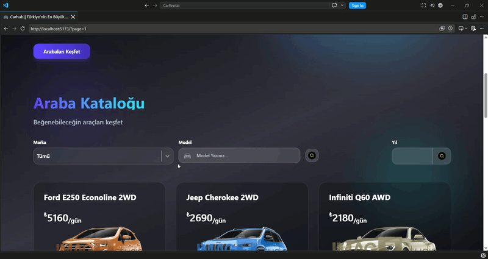

# 🚗 CarHub - Araç Kiralama Platformu

CarHub, kullanıcıların farklı araç modellerini inceleyebildiği, araç özelliklerini karşılaştırabildiği ve ihtiyaçlarına uygun aracı kolayca bulabildiği modern bir araç kiralama web uygulamasıdır.

## 📌 Proje Hakkında

CarHub, kullanıcı dostu bir arayüz ile araç kiralama deneyimini kolaylaştırmak amacıyla geliştirilmiştir. Kullanıcılar araçları listeleyebilir, detaylarını görüntüleyebilir ve kendileri için uygun araç seçeneklerini keşfedebilir.

## ✨ Özellikler

- 🚘 Araç listeleme
- 🔎 Araç arama özelliği
- 📝 Araç detay sayfaları
- 💳 Araç fiyat bilgilerini görüntüleme
- 📍 Araç kategorilerini inceleme
- 📱 Responsive tasarım
- ⚡ Hızlı ve performanslı kullanıcı deneyimi
- 🎨 Modern kullanıcı arayüzü

## 🛠️ Kullanılan Teknolojiler

### Frontend

- React.js
- Vite
- React Router DOM
- Redux Toolkit
- React Redux
- Axios
- Tailwind CSS
- React Icons

### Önizleme

